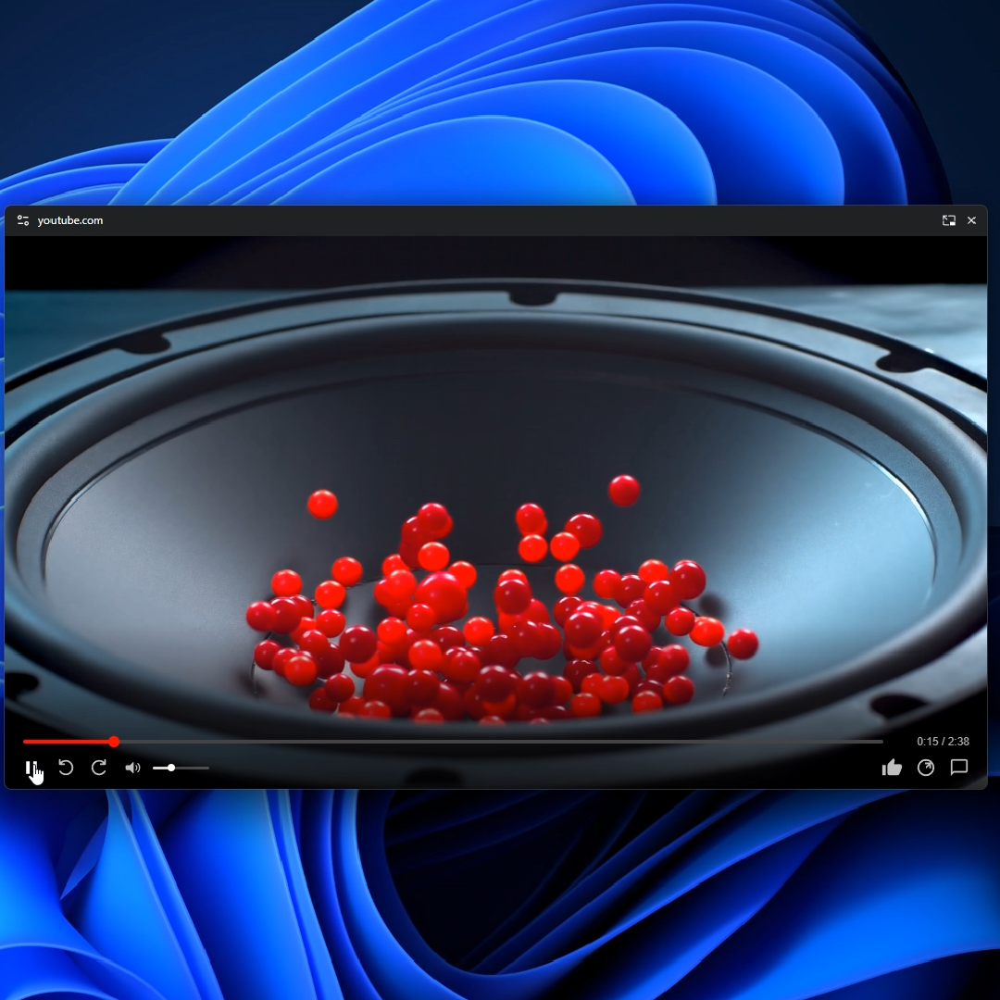

# StreamPiP
Enhanced Picture-in-Picture for Twitch and YouTube

  <b>Perfect for multitasking:</b> Keep tutorials or live streams <u>always on top</u> while you work,  
  study, or browse other tabs <u>without needing a second monitor.</u>

### Installation

1. **Download**: Download this repository as a ZIP file.
2. **Extract**: Unzip the folder to a location on your computer.
3. **Load**: 
    * Open Google Chrome and navigate to `chrome://extensions/`.
    * Toggle <u>**Developer mode**</u> (top right corner).
    * Click <u>**Load unpacked**</u> and select the extracted folder.
4. **Open**: Select any YouTube video or Twitch live stream and click the PiP button located in the lower left corner of the page.
 

  
  
  

 

---

  Created by Simon

